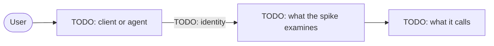

# Foundry agents with LiteLLM, governed by Agent 365

**Question:** How do Foundry hosted and prompt agents use models, MCP tools and A2A 1.0 agents through LiteLLM, as the signed-in user where it matters, with Agent 365 governing the tools?

**Time box:** 5 days · **Status:** in progress

## The setup

TODO: what runs where, in a few sentences, and with which identities; then the diagram of the components (a
`flowchart`, one arrow per call, labelled with the identity it uses).



## Key findings

TODO: once the first experiments are done, one line per question (a table), and a diagram of the most important
behaviour when it helps (a `sequenceDiagram`).

The answers to every question, with the evidence: **[docs/FINDINGS.md](docs/FINDINGS.md)**.

## Documents

| Document | Content |
|---|---|
| [Questions](docs/QUESTIONS.md) | What the spike must answer, and the status of each question |
| [Experiments](docs/experiments/README.md) | One file per experiment, numbered |
| [Findings](docs/FINDINGS.md) | The answers, with links to the evidence |
| [Retest plan](docs/RETEST-PLAN.md) | What to run again when a product changes |
| [Demo runbook](docs/DEMO-RUNBOOK.md) | How to show the results |

## Environment

The infrastructure is a set of azd layers (`infra/<layer>/`, one Terraform root each), listed in `azure.yaml` in the order they are provisioned. Each layer's README-level notes are at the top of its `main.tf`.

```bash
az login && azd auth login
azd env new fa-litellm-a365 --location francecentral
azd env set RESOURCE_TAGS "key=value,key=value"   # tags your tenant's policies require, if any
azd hooks run preprovision                        # remote state backend: run the hooks once before the first preview
azd provision --preview                           # read the plan of every layer before applying
azd provision
```

The gateway: `azd env get-value LITELLM_URL`; its admin UI is at `/ui` (user `admin`), the admin key is in Key Vault:

```bash
az keyvault secret show --vault-name "$(azd env get-value PLATFORM_KEY_VAULT_NAME)" -n litellm-master-key --query value -o tsv
```

The chat UI (`services/chat-ui`, settings in its README) uses a LiteLLM team's key, read from Key Vault. The first
`azd provision` stops at the `chat-ui` layer until that key exists: create the team and its key with the admin key
(a script under `scripts/`), store it as the secret `litellm-key-chat-ui` (or the name in
`CHAT_UI_LITELLM_KEY_SECRET_NAME`), then:

```bash
# Optional: what the page shows and tells the model (also CHAT_UI_INTRO and CHAT_UI_INSTRUCTIONS)
azd env set CHAT_UI_TITLE "Foundry agents with LiteLLM, governed by Agent 365"
azd provision chat-ui --preview && azd provision chat-ui
azd deploy chat-ui            # the first deployment provisions chat-ui again for its port
azd env get-value CHAT_UI_URL
```

Tear it down when the spike ends: `azd down --purge`.

## Run the experiments' code

```bash
uv sync
uv run python src/<script>.py
```
