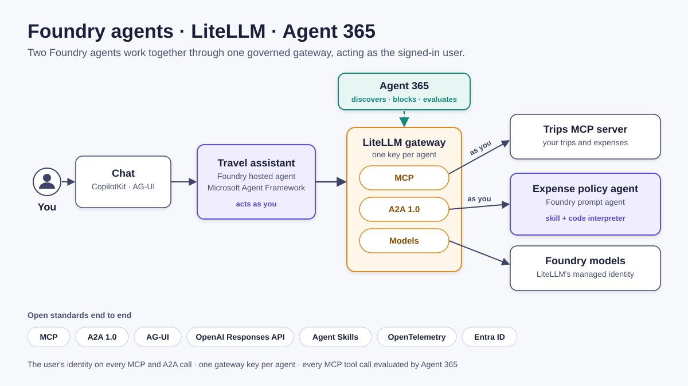
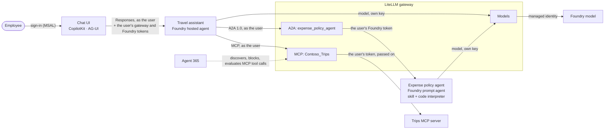
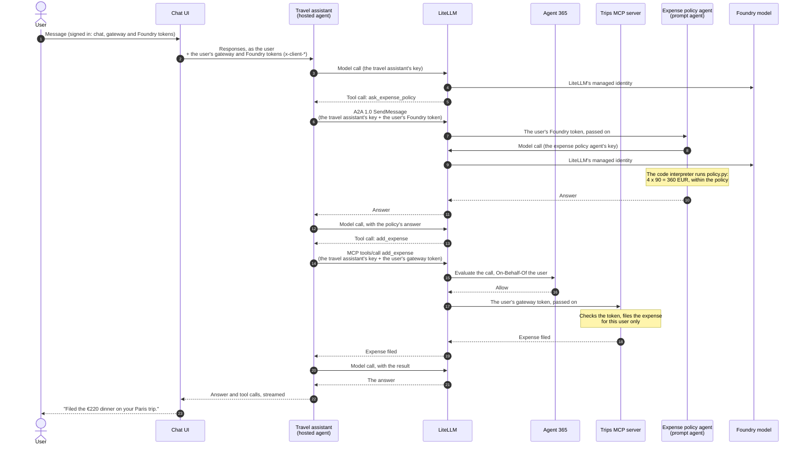

# Foundry agents with LiteLLM, governed by Agent 365



A working sample of two **Microsoft Foundry** agents that work together through a **LiteLLM** gateway, using open protocols end to end, with **Microsoft Agent 365** governing the tools:

- a **hosted agent** (Microsoft Agent Framework, Responses protocol) that acts **as the signed-in user**;
- a **prompt agent** reached over **A2A 1.0**, whose policy is a skill in the open **Agent Skills** format, computed by code in the **code interpreter**;
- models, an **MCP** server and the A2A agent, all **through LiteLLM**, with one key per agent;
- **Agent 365** discovers the MCP tools LiteLLM exposes, blocks and unblocks them, and evaluates every tool call as the user;
- a **CopilotKit** chat (**AG-UI**), **OpenTelemetry** to Application Insights, and infrastructure as **Terraform** layers deployed with **azd**.

The scenario is fictional: Contoso's **travel assistant** reads an employee's trips and files their expenses, after asking Contoso's **expense policy agent** whether each expense fits the policy.

## What you'll see

> **You:** I'm in Paris next week. Is my hotel within the policy, and can I expense a €220 dinner for 4 with the customer?
>
> **Travel assistant** (abridged): Your Paris hotel is within policy: €210 per night is below the €230-per-night limit. The €220 dinner for 4 with a customer is also within policy: the limit is €360 (4 × €90). No manager approval is needed; keep the receipts.
>
> *Tool calls shown under the answer:* `Contoso_Trips-list_trips` (as you, through LiteLLM), `ask_expense_policy` twice (A2A 1.0, as you, through LiteLLM).

Then *"Please file the dinner"* files it on your trip with `Contoso_Trips-add_expense`. When an administrator blocks `add_expense` in Agent 365, the gateway stops offering it within seconds: the assistant still checks the policy but can no longer file expenses, until the tool is unblocked ([Govern with Agent 365](docs/agent365.md)).

## Architecture



### Who acts on each call

One turn, *"Please file the €220 dinner on my Paris trip"*:



| Call | Credential | What the callee sees |
|---|---|---|
| Chat UI → travel assistant | The user's Foundry token, plus the user's gateway and Foundry tokens in `x-client-*` headers, which Foundry passes on to the agent | The signed-in user |
| Travel assistant → LiteLLM → trips MCP server | The agent's LiteLLM key admits the call; LiteLLM passes the user's gateway token on unchanged (`oauth_delegate`) | The user (`oid`), signed in to the chat (`azp`) |
| Travel assistant → LiteLLM → expense policy agent (A2A 1.0) | The agent's LiteLLM key; the user's Foundry token, which LiteLLM passes on | The user (Foundry Agent Consumer role) |
| Travel assistant → LiteLLM → model | The travel assistant's own LiteLLM key | The travel assistant |
| Expense policy agent → LiteLLM → model | The expense policy agent's own LiteLLM key, held in a project connection | The expense policy agent |
| LiteLLM → Foundry model | LiteLLM's managed identity | LiteLLM |
| LiteLLM → Agent 365 (guardrail) | LiteLLM exchanges the user's gateway token On-Behalf-Of the user | The user |

The travel assistant refuses any request that does not carry the user's tokens (HTTP 401): it never falls back to an identity of its own for what it does for the user. LiteLLM's spend logs attribute each call to the key that made it (`travel-assistant`, `expense-policy`).

## What runs where

| Path | What it is |
|---|---|
| [agents/travel-assistant](agents/travel-assistant) | The hosted agent (Python, Agent Framework): builds its tools for each request from the user's tokens ([main.py](agents/travel-assistant/main.py), [user_tokens.py](agents/travel-assistant/user_tokens.py), [a2a.py](agents/travel-assistant/a2a.py)) |
| [agents/expense-policy](agents/expense-policy) | The prompt agent: its role ([agent.json](agents/expense-policy/agent.json)) and its skill ([skill/SKILL.md](agents/expense-policy/skill/SKILL.md), [skill/scripts/policy.py](agents/expense-policy/skill/scripts/policy.py)) |
| [services/trips-mcp](services/trips-mcp) | The trips MCP server: each user's fictional trips and expenses; every tool call needs the user's token |
| [services/chat-ui](services/chat-ui) | The chat (Next.js, CopilotKit, MSAL), in its Foundry mode: it calls the travel assistant as the user, keeps one agent session per chat and shows each tool call as it happens ([services/chat-ui/README.md](services/chat-ui/README.md#foundry-mode)) |
| [src](src) | LiteLLM configuration, the expense policy agent's deployment, a command-line client ([src/README.md](src/README.md)) |
| [infra](infra) | One Terraform root per azd layer, in the order of [azure.yaml](azure.yaml); each layer's notes are at the top of its `main.tf` |

## Deploy

You need an Azure subscription, the right to create app registrations, and a role that can grant tenant-wide admin consent to APIs other than Microsoft Graph, such as Cloud Application Administrator, Application Administrator or AI Administrator (needed again by `azd down` to remove the two consents; the app registrations, which you own, and the Azure resources need no directory role), the [Azure CLI](https://learn.microsoft.com/cli/azure/install-azure-cli), [azd](https://learn.microsoft.com/azure/developer/azure-developer-cli/install-azd) 1.37 or later with the Foundry extensions 1.0 or later, Terraform 1.9 or later, [uv](https://docs.astral.sh/uv/), and Node.js 22 for local checks of the chat UI. Agent 365 must be available in your tenant for the governance part.

```bash
az login && azd auth login
azd extension install azure.ai.agents azure.ai.projects   # or: azd extension upgrade …
azd env new <name> --location francecentral
azd env set RESOURCE_TAGS "key=value"            # optional: tags your organisation's policies require
azd hooks run preprovision                       # remote Terraform state, model quota check
azd up
```

If the quota check finds too little capacity for the model in your region, pick another deployment type or capacity before `azd up`, for example `azd env set MODEL_SKU GlobalStandard` (the default, `DataZoneStandard`, keeps data processing in the EU data zone) or `azd env set MODEL_CAPACITY 20`.

`azd up` provisions the layers in the order of `azure.yaml`, one at a time (each layer depends on the one before it), then deploys the services. Along the way:

- the `agents` layer's hook configures LiteLLM and deploys the expense policy agent ([src](src));
- the travel assistant's postdeploy hook gives its identity read access to its own LiteLLM key and the right to publish telemetry;
- the chat-ui layer's hook pre-authorizes the chat on the gateway app.

To change an environment later, preview each layer you change and read its plan before applying it: `azd provision <layer> --preview`, then `azd provision <layer>`.

Open the chat: `azd env get-value CHAT_UI_URL`. Only the user who deployed is allowed in (the chat layer's `ALLOWED_USER_OBJECT_IDS`), with the Foundry Agent Consumer role on the project (given by the `agents` layer).

Without the chat:

```bash
uv run python src/ask_travel_assistant.py "What are my upcoming trips?"
```

## Govern with Agent 365

Connect LiteLLM to Agent 365, then block and unblock tools: see [docs/agent365.md](docs/agent365.md).

## Observe

- **Application Insights** receives OpenTelemetry from the chat, the travel assistant and LiteLLM. Each Agent 365 evaluation is a `guardrail` dependency with its verdict, for example `{"verdict": "Allow", "defender_status": "Evaluated"}`.
- **LiteLLM's spend logs** (`/ui`, user `admin`, the admin key in Key Vault as `litellm-master-key`) show each call with the alias of the key that made it.
- **The trips MCP server's log** shows, for each tool call, the user (`oid`) and the application they signed in to (`azp`).

## Design notes

- **Two kinds of agents, two roles.** The travel assistant is code (a hosted agent), so it can bind each request to the user's tokens and build its tools per request. The expense policy agent is configuration (a prompt agent): instructions, a model, the code interpreter. Foundry exposes a prompt agent over A2A directly, so the expense policy agent is the one reached over A2A, with no server code of its own.
- **Figures come from code.** The policy's limits and checks are in [policy.py](agents/expense-policy/skill/scripts/policy.py), which the expense policy agent runs in the code interpreter for every answer. The skill folder follows the open Agent Skills format, so it can also be published as a Foundry skill.
- **One key per agent.** Each agent's LiteLLM key allows exactly the models, MCP servers and A2A agents it uses, and names it in LiteLLM's logs.
- **A user token on every MCP call.** The Agent 365 guardrail evaluates each MCP tool call as the user, and LiteLLM's open-source edition applies guardrails to every key alike. So every MCP call through LiteLLM carries a user token, and the expense policy agent, which acts as itself, calls no MCP server.
- **The user's token reaches the trips server.** LiteLLM passes the user's gateway token on unchanged (`oauth_delegate`), and the trips server checks it (tenant, the gateway app's audience, the `Tools.Use` scope) before any tool runs. Discovery (`initialize`, `tools/list`) needs no token, so that Agent 365 can list the tools with its own key; tool definitions hold no user data. LiteLLM's On-Behalf-Of exchange (`oauth2_token_exchange`) would give the trips server a token of its own audience, but it then needs a user token for discovery as well, which Agent 365 does not send.
- **Credentials.** Users and agents act with Entra tokens: the users' own tokens, managed identities for the services (LiteLLM to the models, the trips MCP server to its storage), and the travel assistant's agent identity (to Key Vault and Application Insights). Each agent's LiteLLM key is kept in Key Vault, and the expense policy agent's in a project connection. The one client secret, the gateway app's (for the Agent 365 guardrail's On-Behalf-Of exchange), is kept in Key Vault and in LiteLLM's database.
- **A responsive chat.** A new hosted-agent session starts a container, which takes a few seconds. The chat starts the agent's session as soon as a chat opens and reuses it for every message of that chat (`agent_session_id`), so answers do not wait for it; tool calls are shown as soon as the agent reports them, since a question to the expense policy agent over A2A takes a few seconds.

Versions used (November 2026): LiteLLM v1.106.6, Microsoft Agent Framework 1.22, MCP Python SDK 2.3, CopilotKit 1.79, azd 1.37 with the Foundry extensions 1.0, model `gpt-6-luna`.

## Clean up

Delete the two agents first, so that their Entra agent identities go with them:

```bash
for agent in travel-assistant expense-policy; do
  az rest --method delete --resource https://ai.azure.com \
    --url "$(azd env get-value FOUNDRY_PROJECT_ENDPOINT)/agents/$agent?api-version=v1&force=true"
done
azd down --purge
```

`azd down --purge` deletes the resource group and purges the Key Vault and the Foundry account. The app registrations created by the `entra-apps` and `chat-ui` layers are deleted with their layers. Remove the LiteLLM gateway from Agent 365 (Gateways) too.

## License

[MIT](LICENSE)
